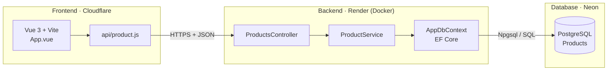

# Inventory System

## The main structure

**Live Demo:** https://inventory.cj9mw2vfpw.workers.dev
(後端在 Render 免費方案,閒置後第一次開啟需等約 1 分鐘)

## Tech Stack
- Frontend: Vue 3 + Vite, Cloudflare
- Backend: ASP.NET Core Web API, EF Core
- Database: PostgreSQL (Neon)
- Test: xUnit

## Features
- 商品新增、編輯、刪除
- 關鍵字搜尋、分類與庫存狀態篩選、分頁
- 庫存狀態自動計算(缺貨 / 低庫存 / 正常)
